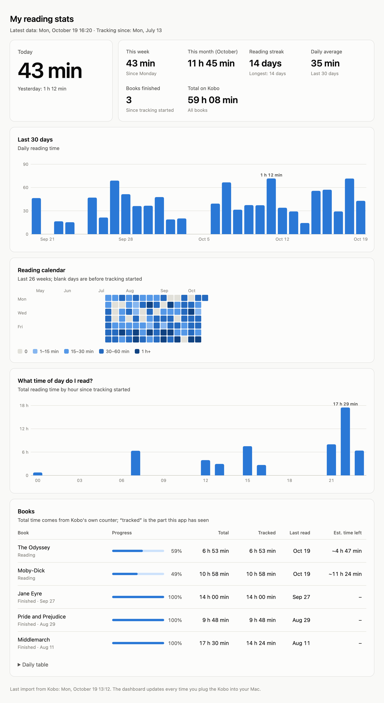

# Kobo Reading Stats

**English** · [Türkçe](README.tr.md)

See how much you read each day on your Kobo e-reader.

Kobo only keeps a running total of reading time per book, so it can't tell you how much you read on a given day. This project adds two small pieces:

1. **A logger on the Kobo** that checks Kobo's own database once a minute and saves any change to a file on the device.
2. **A script on your Mac** that imports those records when you plug the Kobo in and builds a local dashboard.

No Wi-Fi, account, cloud service or extra Python packages are needed. Records stay on the device until you plug it in, so it doesn't matter how often you connect it.

<picture>
  <source media="(prefers-color-scheme: dark)" srcset="docs/dashboard-dark.png">
  
</picture>

<sub>The screenshot uses made-up data.</sub>

## What you get

- Today, this week, this month and your daily average
- Reading streak (current and longest)
- A 30-day bar chart and a 26-week calendar heatmap
- What time of day you read
- Per-book progress, total time, and an estimate of time left based on your own reading speed
- A count of books finished since tracking started
- A notification with today's total when you plug the Kobo in
- A warning on the dashboard if the logger on the Kobo stops running, for example after a firmware update
- English or Turkish, following your macOS language

## Requirements

- **A Kobo e-reader.** Tested on a Kobo Clara BW (N365) with firmware 4.45 and 4.46, reading KEPUB books. Other recent Kobo models should work, but they haven't been tested.
- **A Mac** (Apple Silicon or Intel) with the system Python at `/usr/bin/python3`. If it's missing, macOS offers to install the Command Line Tools the first time you run `python3`.
- An internet connection the first time you run `build.sh`.

## Installation

Clone the repository somewhere it can stay. The Mac app points to this folder.

```sh
git clone https://github.com/Alihanayd/Kobo-reading-stats.git
cd Kobo-reading-stats
```

### 1. Install the logger on the Kobo

```sh
./build.sh
cp -X build/KoboRoot.tgz /Volumes/KOBOeReader/.kobo/
```

Eject the Kobo. It installs the package and restarts.

`build.sh` downloads the [Zig](https://ziglang.org) compiler and the SQLite source into `build/` and checks both against known hashes. It then builds a small static `sqlite3` for the Kobo's ARM processor and packs everything into `KoboRoot.tgz`. That file is the standard way to install add-ons on a Kobo; tools such as NickelMenu and KFMon use it too. The package runs as root on the device, so read the scripts in `kobo/` before installing it. They're short.

After building, you can delete `build/zig-*` and `build/sqlite-*`. They're only needed again if you delete `kobo/usr/local/reading-stats/sqlite3`.

### 2. Set up the Mac side

```sh
mac/install.sh
```

This creates a small app, `~/Applications/Kobo Reading Stats.app`, and a launchd agent that runs it in the background whenever a disk is mounted. If the disk isn't a Kobo, it exits right away.

The script runs through an app because macOS doesn't let background Python processes read removable drives. The first time you plug the Kobo in, macOS asks whether **Kobo Reading Stats** may access files on a removable volume. Click Allow. If the repository is inside Desktop, Documents or Downloads, macOS asks for that folder too. Running `install.sh` again rebuilds the app, so macOS asks again.

## Usage

- Read on your Kobo as usual.
- Plug it into your Mac now and then. The records are imported and you get a notification.
- To open the dashboard, search for **Kobo Reading Stats** in Spotlight, or open `data/dashboard.html` in any browser.

You can also run the script by hand:

```sh
python3 mac/kobo_stats.py               # import from the Kobo if it's plugged in, then open the dashboard
python3 mac/kobo_stats.py --dashboard   # only rebuild and open the dashboard
```

Your data is stored in `data/reading.db` (SQLite). Set `KOBO_STATS_DATA` to keep it somewhere else.

### Language

The dashboard, notifications and console messages are in English or Turkish. By default the script follows macOS: Turkish if your first preferred language is Turkish or your region is Turkey (for example `tr-TR` or `en-TR`), English otherwise. To pick one yourself, set `KOBO_STATS_LANG` to `en` or `tr`:

```sh
KOBO_STATS_LANG=en python3 mac/kobo_stats.py --dashboard
```

The background app doesn't see your shell's environment, so to keep the same language when the dashboard updates on plug-in, pass the variable to the installer as well: `KOBO_STATS_LANG=en mac/install.sh`.

## How it works

```
Kobo, every 60 s while awake                     Mac, when the Kobo is plugged in
────────────────────────────                     ────────────────────────────────
.kobo/KoboReader.sqlite                          .adds/reading-stats/history.tsv
  └─ per-book TimeSpentReading,                    + a fresh read of KoboReader.sqlite
     percent read, status, last read                 └─ data/reading.db
        └─ only rows that changed                        └─ data/dashboard.html
           are appended to
           .adds/reading-stats/history.tsv
```

- Reading time recorded before tracking started is counted as "before tracking" and isn't spread over days.
- Each later increase is assigned to the time just before Kobo's "last read" timestamp and split across days and hours. A session that runs past midnight is split across both days.
- If a book's time goes down (the book was reset), the new time counts as read from scratch.
- "Time left" uses that book's average speed so far, in percent per hour.

### Files on the Kobo

| Path | Purpose |
|---|---|
| `/etc/udev/rules.d/98-reading-stats.rules` | Starts the logger at boot |
| `/usr/local/reading-stats/start.sh` | Detaches from udev and makes sure only one copy runs |
| `/usr/local/reading-stats/logger.sh` | The loop that takes a reading once a minute |
| `/usr/local/reading-stats/sqlite3` | Reads Kobo's database in read-only mode |

The logger writes these files to `.adds/reading-stats/` on the Kobo's storage:

- `history.tsv`: the change log. Tab-separated columns: Unix time, ContentID, seconds read, percent read, status (0 unread, 1 reading, 2 finished), last read, title.
- `last-state.tsv`: the previous reading, used for comparison.
- `heartbeat`: the last time the logger ran. It's written once an hour.
- `logger.log`: start-up messages and errors.

## Troubleshooting

- **The dashboard says the logger isn't running.** A Kobo firmware update may have removed it. Copy `build/KoboRoot.tgz` to `.kobo/` again and eject the Kobo.
- **No notification when you plug in.** Check `data/auto.log`. If it mentions a permission error (`permission error`, or `izin hatası` in Turkish), open System Settings > Privacy & Security > Files & Folders and turn on Removable Volumes for Kobo Reading Stats.
- **Nothing is recorded on the Kobo.** Plug it in and look for `.adds/reading-stats/logger.log`. It should contain a line with `started`.

## Uninstalling

- **From the Kobo:** plug it in, create an empty file named `UNINSTALL` in `.adds/reading-stats/`, and eject it. Within a minute the logger deletes its own files and the udev rule, and renames the file to `UNINSTALLED`. Your records stay where they are.
- **From the Mac:** `mac/uninstall.sh` removes the app and the launchd agent. It doesn't touch `data/`.

## Limitations

- Kobo updates its time counter for KEPUB books. Plain EPUB and PDF files may not be counted.
- Kobo firmware updates may remove the logger. The dashboard warns you when that happens, and you reinstall it the same way.
- The dashboard and notifications come in English and Turkish only.

## Privacy

Everything stays on your Kobo and your Mac. Nothing is sent anywhere. The `data/` folder with your reading history is excluded from git.

## License

[MIT](LICENSE)
