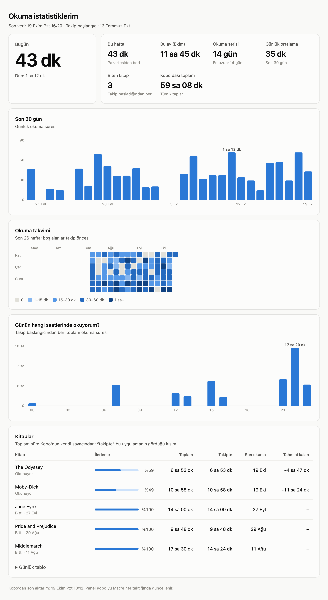

# Kobo okuma istatistikleri

[English](README.md) · **Türkçe**

Kobo Clara BW'de günlük ne kadar okuduğumu takip eden küçük bir sistem.

<picture>
  <source media="(prefers-color-scheme: dark)" srcset="docs/dashboard-dark.tr.png">
  
</picture>

<sub>Ekran görüntüsündeki veriler uydurmadır.</sub>

Kobo kitap başına sadece *toplam* okuma süresini tutuyor, gün gün geçmiş tutmuyor. Bu yüzden iki parça var:

1. **Kobo'daki kayıt betiği** (`kobo/`). Kobo açıkken dakikada bir Kobo'nun veritabanına bakar. Bir kitabın süresi, yüzdesi ya da durumu değiştiyse o satırı zaman damgasıyla `.adds/reading-stats/history.tsv` dosyasına ekler. Wi-Fi ya da bilgisayar gerekmez, kayıtlar cihazda birikir.
2. **Mac tarafı** (`mac/`). Kobo Mac'e takılınca kayıtları `data/reading.db` veritabanına alır ve `data/dashboard.html` sayfasını üretir. Sayfada bugün, bu hafta, bu ay, okuma serisi, 30 günlük grafik, takvim, okunan saatler ve kitap bazında ilerleme ile kalan süre tahmini var.

Docker ya da başka bir servis gerekmez. Mac tarafı macOS'un kendi Python'u (`/usr/bin/python3`) ile çalışır, ek paket kullanmaz.

## Kullanım

- Kobo'yu her zamanki gibi kullan.
- Ara sıra Mac'e tak. Kayıtlar kendiliğinden alınır ve bir bildirim gelir ("Bugün 45 dk okudun").
- Paneli görmek için Spotlight'tan **Kobo Reading Stats**'i aç ya da `data/dashboard.html`'i aç.

Kobo'yu ne kadar seyrek taktığın önemli değil, günlük ayrım cihazda yapılıyor.

## Dil

Panel, bildirimler ve konsol mesajları Türkçe ya da İngilizce. Varsayılan olarak macOS'un diline bakılır: ilk tercih edilen dil Türkçe ya da bölge Türkiye ise (örneğin `tr-TR`, `en-TR`) Türkçe, değilse İngilizce. Elle seçmek için `KOBO_STATS_LANG`'i `tr` ya da `en` yap:

```sh
KOBO_STATS_LANG=tr python3 mac/kobo_stats.py --dashboard
```

Arka plandaki uygulama kabuğun ortam değişkenlerini görmez. Kobo takılınca güncellenen panelin de aynı dilde kalması için değişkeni kurulumda da ver: `KOBO_STATS_LANG=tr mac/install.sh`.

## Kurulum

### Kobo

```sh
./build.sh                                        # build/KoboRoot.tgz üretir
cp -X build/KoboRoot.tgz /Volumes/KOBOeReader/.kobo/
```

Sonra Kobo'yu Mac'ten çıkar. Kobo paketi kurar ve yeniden başlar.

`build.sh` Zig derleyicisini ve SQLite kaynak kodunu `build/` altına indirir (imzaları doğrulanır). SQLite komut satırı aracını Kobo'nun ARM işlemcisi için statik olarak derler.

Pakete girenler:

| Cihazdaki yol | Ne işe yarar |
|---|---|
| `/etc/udev/rules.d/98-reading-stats.rules` | Açılışta `start.sh`'yi çalıştırır |
| `/usr/local/reading-stats/start.sh` | udev'den ayrılır, betiğin tek kopya çalışmasını sağlar |
| `/usr/local/reading-stats/logger.sh` | Dakikada bir kayıt alan döngü |
| `/usr/local/reading-stats/sqlite3` | Kobo'nun veritabanını salt-okunur sorgulamak için |

Cihazda üretilen dosyalar (`.adds/reading-stats/`):

- `history.tsv`: Değişiklik kayıtları. Sütunlar: unix zamanı, ContentID, saniye, yüzde, durum, son okuma, başlık.
- `last-state.tsv`: Bir önceki turun durumu (karşılaştırma için).
- `heartbeat`: Betiğin en son çalıştığı an (saatte bir yazılır).
- `logger.log`: Başlangıç ve hata kayıtları.

### Mac

```sh
mac/install.sh
```

Bu komut `~/Applications/Kobo Reading Stats.app` uygulamasını oluşturur. Ayrıca herhangi bir disk bağlandığında bu uygulamayı `--auto` ile çalıştıran bir launchd görevi kurar (`~/Library/LaunchAgents/io.github.alihanayd.kobo-reading-stats.plist`).

macOS arka plandaki Python'un çıkarılabilir disklere erişmesine izin vermiyor. Bu yüzden betik uygulama üzerinden çalışıyor. İlk seferde macOS "Kobo Reading Stats çıkarılabilir birimdeki dosyalara erişmek istiyor" diye sorar; İzin Ver demek yeterli. Uygulama yeniden derlenirse (yani `install.sh` tekrar çalıştırılırsa) bu izni yeniden ister.

## Nasıl hesaplanıyor?

- Takip başladığı andaki süreler "geçmiş" sayılır ve günlere dağıtılmaz.
- Sonraki her kayıtta süredeki artış, Kobo'nun "son okuma" zamanından geriye doğru o kadar süre olarak günlere ve saatlere bölünür. Bu sayede gece yarısını aşan okumalar da doğru günlere düşer.
- Kitap sıfırlanırsa (süre azalırsa) yeni süre baştan okunmuş sayılır.
- Kalan süre tahmini, kitabın şimdiye kadarki ortalama hızına göre (yüzde / saat) hesaplanır.

## Sorun giderme

- **Panelde "kayıt betiği çalışmıyor" uyarısı var:** Kobo yazılım güncellemeleri betiği silebilir. `build/KoboRoot.tgz`'yi tekrar `.kobo/` klasörüne kopyalayıp Kobo'yu çıkar.
- **Takınca bildirim gelmiyor:** `data/auto.log` dosyasına bak. "izin hatası" (İngilizcede "permission error") yazıyorsa Sistem Ayarları > Gizlilik ve Güvenlik > Dosyalar ve Klasörler'de Kobo Reading Stats için "Çıkarılabilir Birimler"i aç.
- **Kobo'da kayıt tutulmuyor:** Kobo'yu tak, `.adds/reading-stats/logger.log` dosyasına bak. İçinde `started` yazan bir satır olmalı.
- Elle çalıştırmak için: `python3 mac/kobo_stats.py` (Kobo takılıysa kayıtları alır, paneli açar) ya da `--dashboard` (sadece paneli üretir).

## Kaldırma

- **Kobo'dan:** Kobo'yu tak, `.adds/reading-stats/` klasöründe `UNINSTALL` adında boş bir dosya oluştur, Kobo'yu çıkar. Betik bir dakika içinde kendi dosyalarını ve udev kuralını siler; dosyanın adı `UNINSTALLED` olur. Kayıtlar yerinde kalır.
- **Mac'ten:** `mac/uninstall.sh` uygulamayı ve launchd görevini kaldırır. `data/` silinmez.
